# Scout Matériel — Guide de l'utilisateur

Version d'octobre 2026 · existe aussi en [PDF](guide-utilisateur.pdf).

## 1. Présentation et connexion

Scout Matériel sert à emprunter le matériel du groupe : l'invité choisit des objets et envoie une demande, l'administrateur réserve ou refuse chaque article puis marque son retour. Tout se fait depuis un navigateur, sur ordinateur comme sur téléphone.

| Rôle | Ce qu'il peut faire |
| --- | --- |
| Invité (chef d'unité, responsable de camp…) | Parcourir l'inventaire, remplir un panier, envoyer des demandes, suivre et annuler ses demandes. |
| Administrateur | Tout ce que fait l'invité, plus le menu **Gestion** : traiter les demandes, gérer le matériel, les catégories, les comptes et l'import Excel. |

Captures réalisées sur une instance de démonstration : l'invitée s'appelle Louise Martin, l'administrateur « chef ».

### Se connecter

Ouvrez l'adresse du site et saisissez votre identifiant (ou votre e-mail) et votre mot de passe. La session reste ouverte 90 jours sur l'appareil : vous n'aurez pas à vous reconnecter à chaque fois.

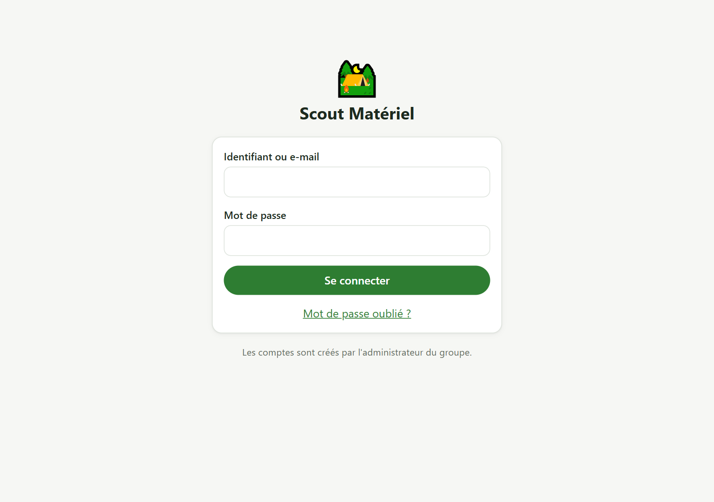

Il n'y a pas d'inscription libre : c'est l'administrateur qui crée les comptes. Mot de passe oublié ? Cliquez sur le lien sous le bouton, saisissez votre e-mail et suivez le lien reçu.

### Première connexion : le lien d'invitation

Quand l'administrateur crée votre compte, vous recevez un e-mail avec un lien personnel. Ce lien ouvre la page « Bienvenue » où vous choisissez votre mot de passe.

1. Cliquez sur le lien de l'e-mail (valable 7 jours, une seule fois).
2. Choisissez un mot de passe d'au moins 12 caractères. Une petite phrase est plus facile à retenir.
3. Confirmez-le puis cliquez sur **Enregistrer et me connecter** : vous arrivez directement sur l'accueil.

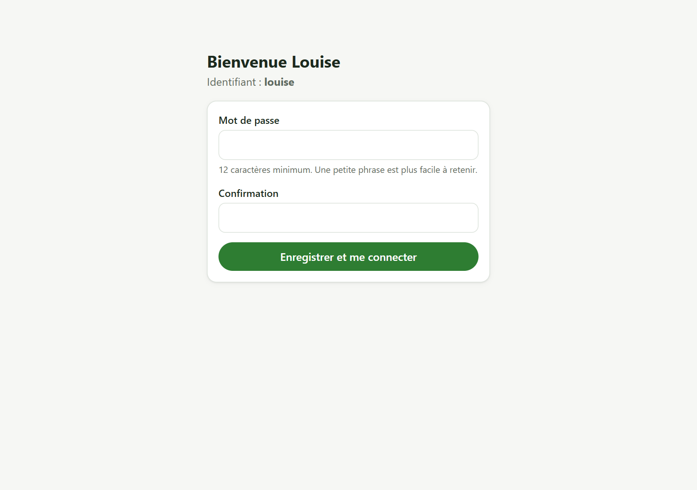

## 2. Parcours invité : emprunter du matériel

Un emprunt se fait en quatre temps : choisir les objets, vérifier le panier, envoyer la demande, puis suivre la réponse de l'administrateur article par article. Aucune date ni message n'est demandé : précisez-les directement à l'administrateur si besoin.

### Étape 1 — L'accueil

L'accueil donne accès à tout : **Matériel**, **Panier** (avec le nombre d'articles), **Mes demandes** et **Mon mot de passe**. La barre du haut reprend ces liens ; l'icône 🛒 affiche le nombre d'articles du panier.

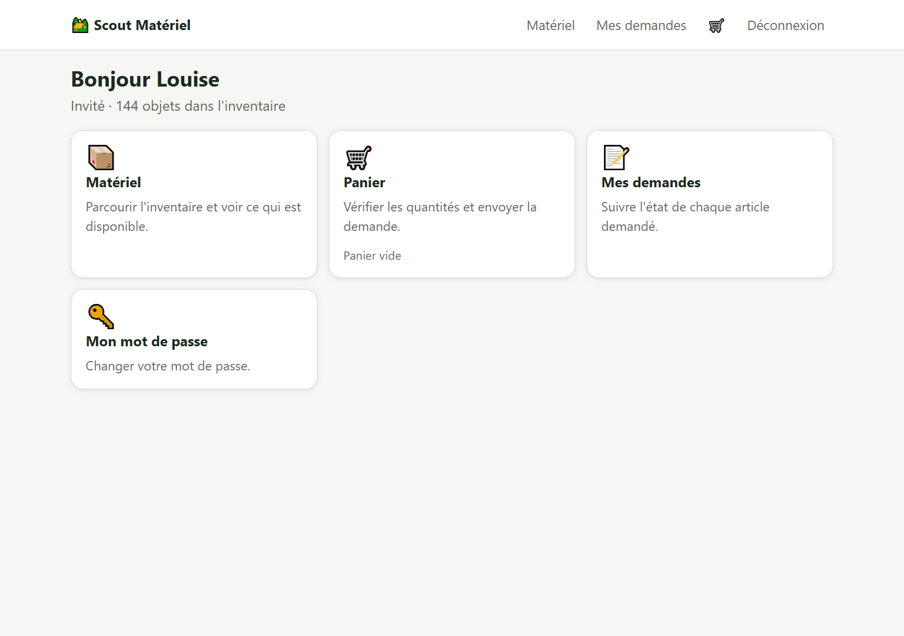

### Étape 2 — Parcourir le matériel

Le matériel est rangé par familles (Cuisine collective, Camping et hébergement, Outillage…). Chaque carte indique le nombre d'objets visibles.

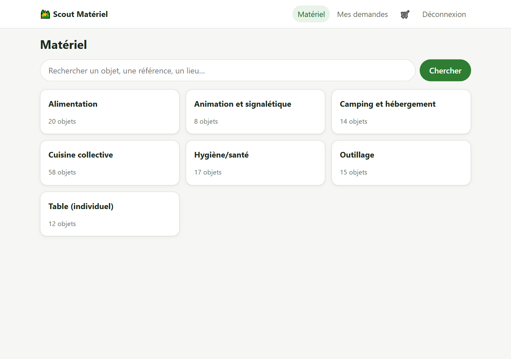

Dans une famille, les puces du haut ouvrent une sous-catégorie ; en dessous, les objets sont groupés par rangée. Chaque ligne montre la référence, l'emplacement 📍 et un badge de disponibilité. Le bouton rond **+** ajoute directement un exemplaire au panier.

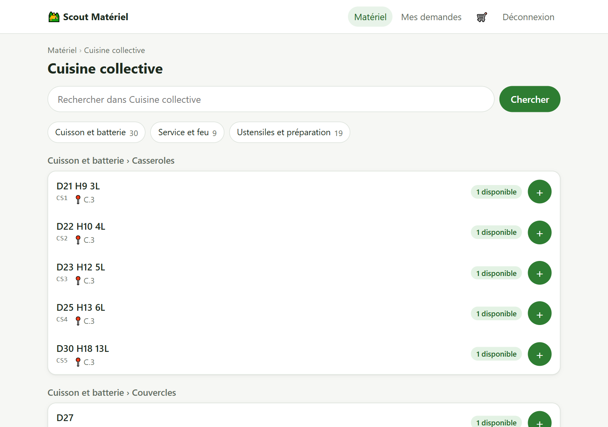

La barre de recherche trouve un objet par son nom, sa référence ou son emplacement, dans tout l'inventaire ou dans la famille ouverte.

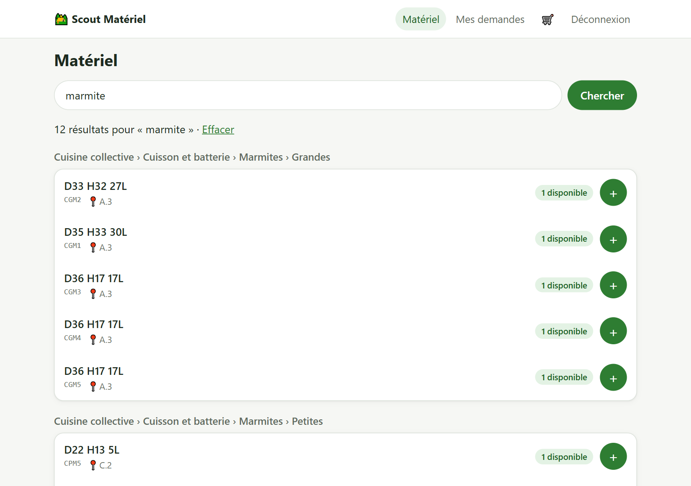

| Badge | Signification |
| --- | --- |
| `N disponibles` (vert) | Vous pouvez en demander jusqu'à N. |
| `Consommable` (gris) | Visible pour information, mais pas réservable (alimentation, consommables…). |

Un objet entièrement réservé par d'autres n'apparaît pas : il reviendra dès qu'il sera rendu.

### Étape 3 — La fiche d'un objet

Cliquez sur un objet pour ouvrir sa fiche : référence, quantité disponible, emplacement et commentaire. Indiquez la quantité voulue puis **Ajouter au panier**. Si l'objet est déjà dans votre panier, la fiche le rappelle.

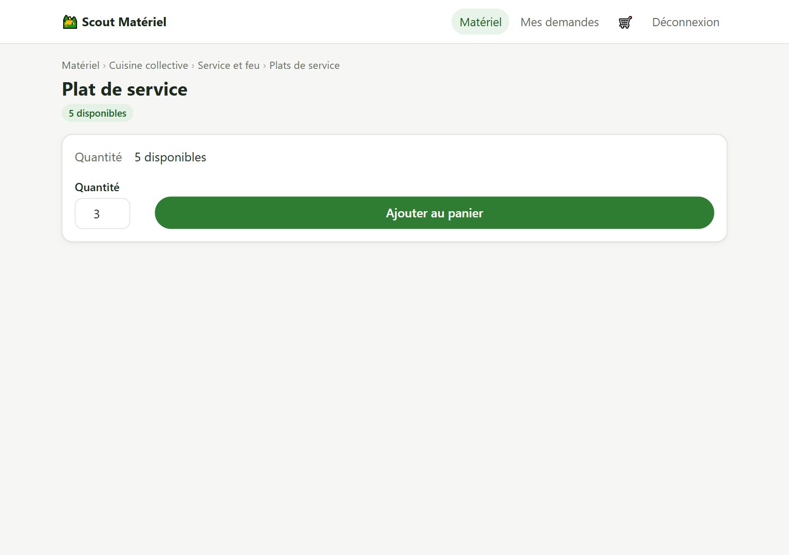

### Étape 4 — Vérifier le panier et envoyer

Le panier liste vos articles avec leur chemin de rangement. Modifiez une quantité dans la case, retirez un article avec **×**. Le panier est gardé sur le serveur : vous le retrouvez sur un autre appareil.

Quand tout est prêt, cliquez sur **Envoyer la demande**. La disponibilité est revérifiée à ce moment : si un objet a été réservé entre-temps, un message l'indique et rien n'est envoyé. Vous recevez un e-mail de confirmation et l'administrateur est prévenu.

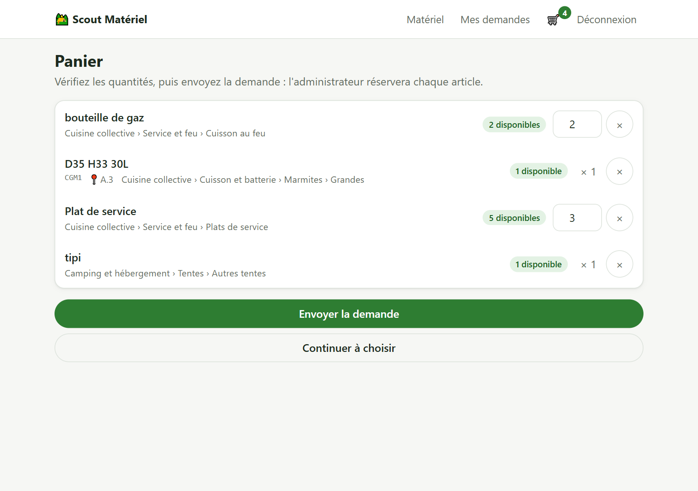

### Étape 5 — Suivre ses demandes

**Mes demandes** liste vos demandes, de la plus récente à la plus ancienne, avec leur état global et le nombre d'articles encore en attente.

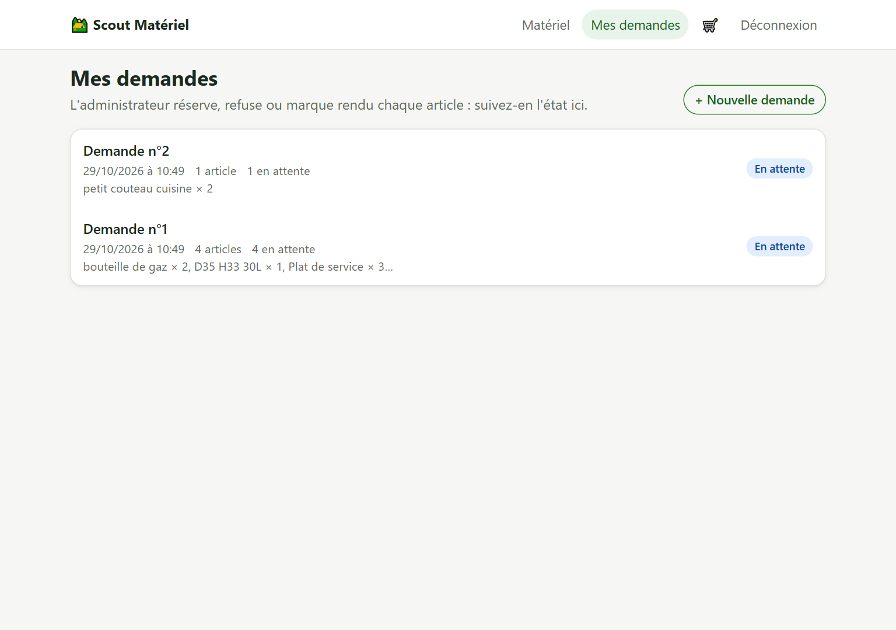

Ouvrez une demande pour voir l'état de chaque article. Tant que des articles sont en attente, le bouton **Annuler les articles en attente** permet de les retirer ; les articles déjà réservés ne sont pas touchés, l'administrateur est prévenu par e-mail.

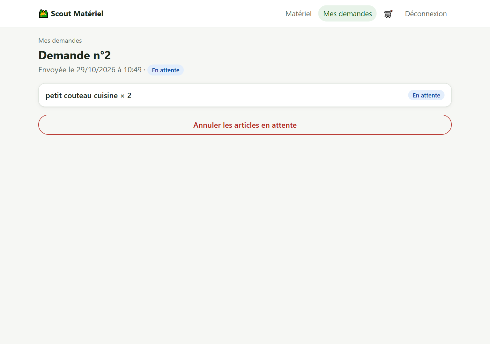

Après le passage de l'administrateur, chaque ligne affiche sa décision et, le cas échéant, son commentaire 💬. Ici, deux plats sur trois ont été réservés et le tipi refusé. Aucun e-mail n'est envoyé pour ces décisions : consultez la page.

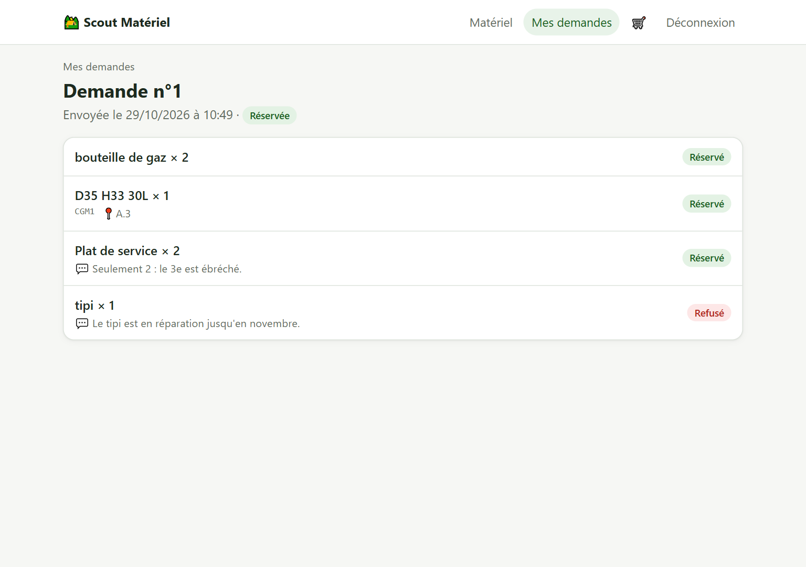

### Sur téléphone

Sur un écran étroit, la navigation passe en bas de l'écran (Accueil, Matériel, Panier, Demandes) et les boutons **+** restent à portée de pouce. Le site peut être ajouté à l'écran d'accueil comme une application.

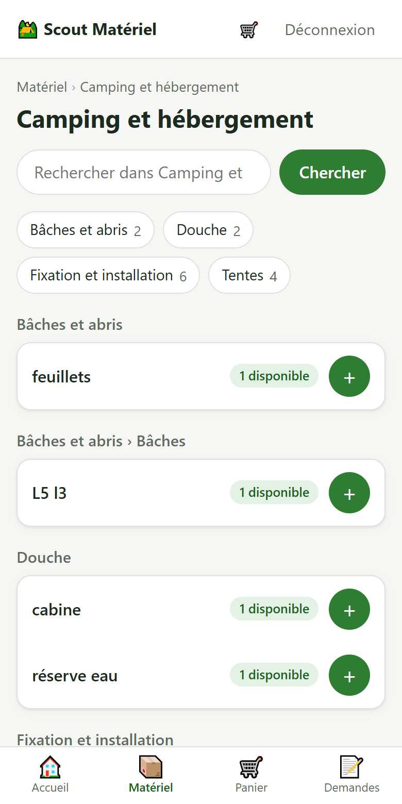

## 3. Parcours administrateur : gérer le matériel

L'administrateur voit les mêmes pages qu'un invité, avec en plus le menu **Gestion** et des boutons **✎ Modifier** et **+ Nouvel objet**. Son travail courant : traiter les demandes, puis marquer le matériel rendu au retour.

### L'accueil et le menu Gestion

L'accueil ajoute deux cartes : **Demandes à traiter** (avec le nombre en attente) et **Gestion**. Le même compteur apparaît dans la barre du haut, à côté de « Gestion ».

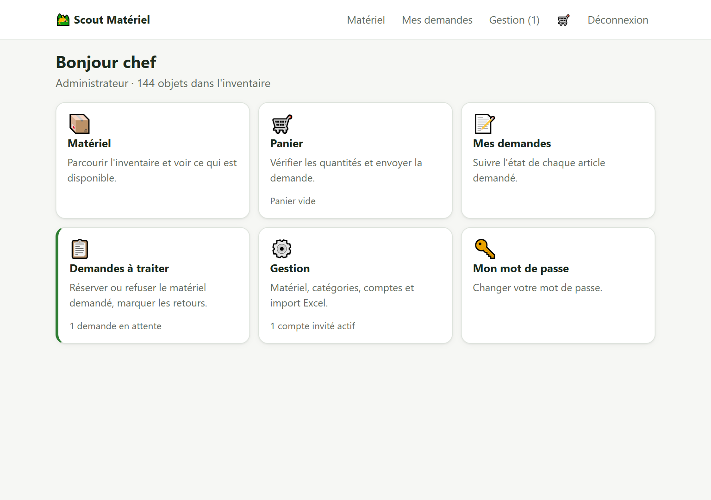

**Gestion** regroupe six rubriques : Demandes, Matériel, Catégories, Comptes, Import Excel et Réglages.

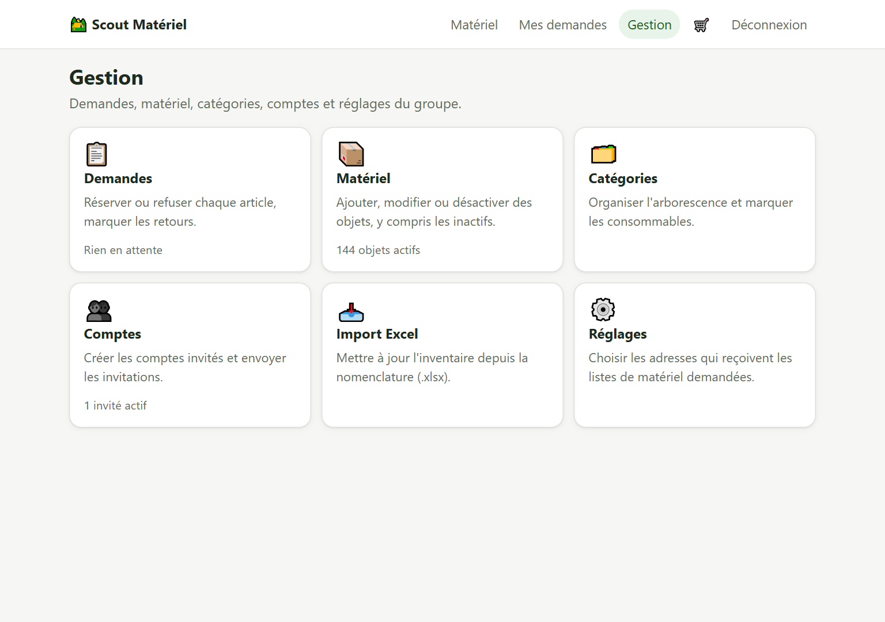

### Traiter une demande

Chaque nouvelle demande déclenche un e-mail aux adresses choisies dans **Gestion › Réglages** (voir plus bas), avec la liste du matériel et son emplacement. Dans **Gestion › Demandes**, trois onglets trient les demandes : **À traiter** (au moins un article en attente), **Réservées** (matériel sorti) et **Toutes**.

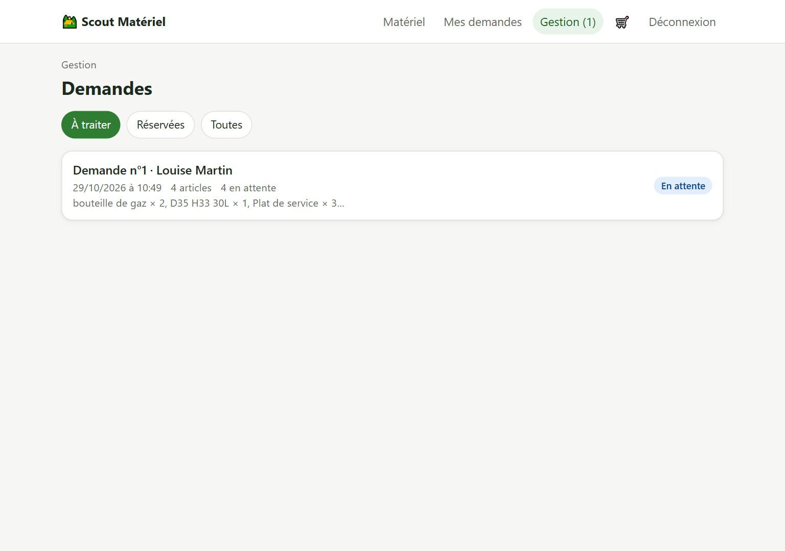

Ouvrez la demande. Pour chaque article, vous voyez combien d'exemplaires sont disponibles et choisissez une **Décision** :

- **Réserver** : le matériel est bloqué pour l'invité. Pour un article demandé en plusieurs exemplaires, vous pouvez en réserver moins (champ **Quantité réservée**).
- **Refuser** : l'article n'est pas prêté.
- **— Ne rien changer —** : l'article reste en attente, vous y reviendrez plus tard.

Le **Commentaire pour l'invité** est facultatif ; il s'affiche sous l'article dans la demande de l'invité. Cliquez ensuite sur **Enregistrer les décisions**. Le bouton **✅ Tout réserver** fait la même chose pour tous les articles en attente, en un clic.

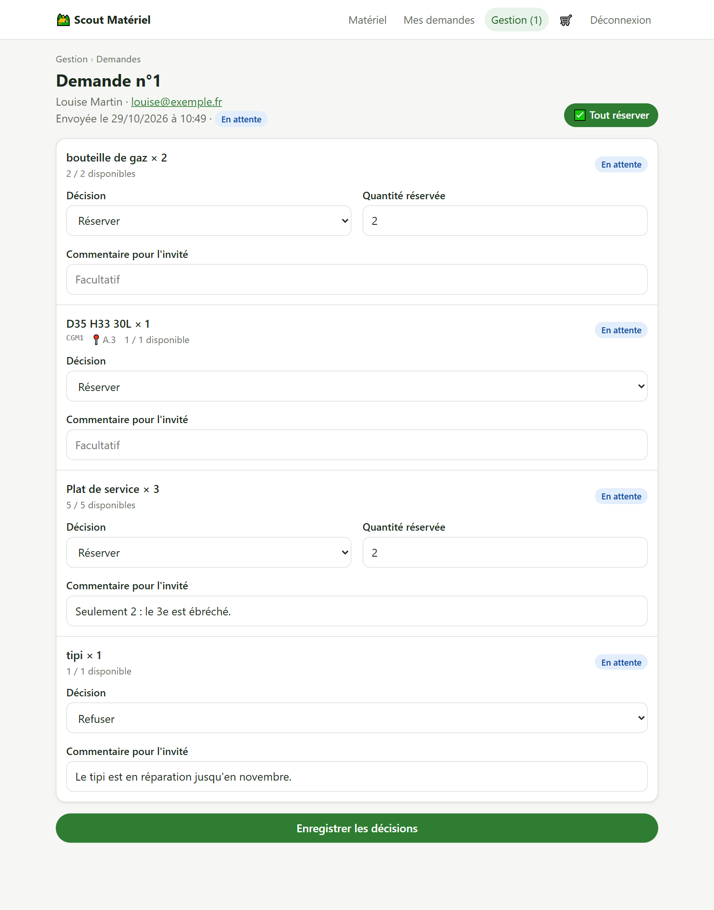

L'enregistrement est tout-ou-rien : si un seul article n'est plus disponible, rien n'est enregistré et un message indique lequel. L'invité n'est pas prévenu par e-mail : pensez à le lui dire si c'est urgent.

### Marquer le retour du matériel

Au retour du camp, ouvrez la demande depuis l'onglet **Réservées**. Choisissez **Rendu** article par article, ou cliquez sur **↩️ Tout marquer rendu**. Le matériel redevient aussitôt disponible et la demande passe à « Terminée ». Pour libérer un article sans qu'il soit sorti, choisissez **Annuler la réservation**.

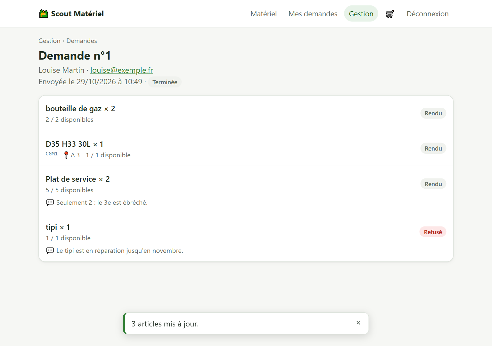

### Voir qui a réservé un objet

Sur la fiche d'un objet, l'administrateur voit en plus la quantité totale, le nombre réservé et la liste **Réservations en cours** (qui, combien, depuis quand), ainsi que les demandes encore en attente. Chaque ligne mène à la demande.

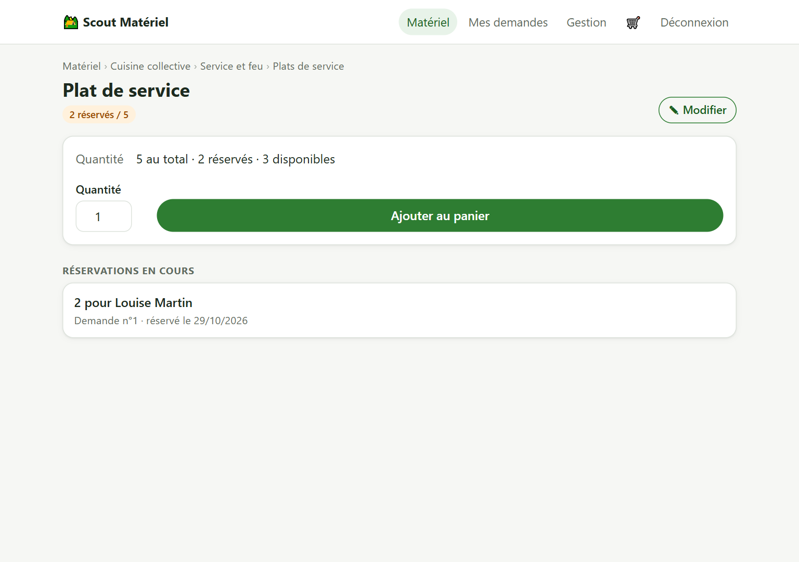

### Gérer le matériel

**Gestion › Matériel** liste tous les objets, y compris les inactifs. Filtrez par état (Actifs, Inactifs, Tous) et par famille, ou cherchez par nom, référence ou lieu. **+ Nouvel objet** ouvre un formulaire vide ; **✎** ouvre la fiche d'édition.

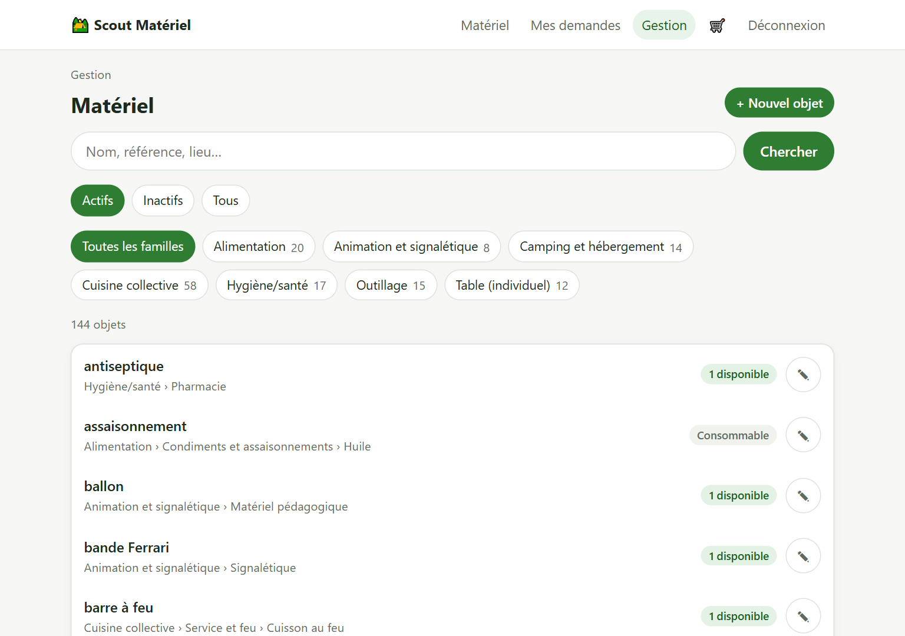

La fiche d'édition contient : nom, catégorie, référence (facultative mais unique), quantité totale, localisation, commentaire visible par tous, remarque d'import visible du seul administrateur, et deux cases :

- **Consommable** : l'objet reste visible mais ne peut pas être demandé.
- **Actif** : décochez-la pour retirer un objet de l'inventaire sans perdre son historique. Préférez-la à **Supprimer**.

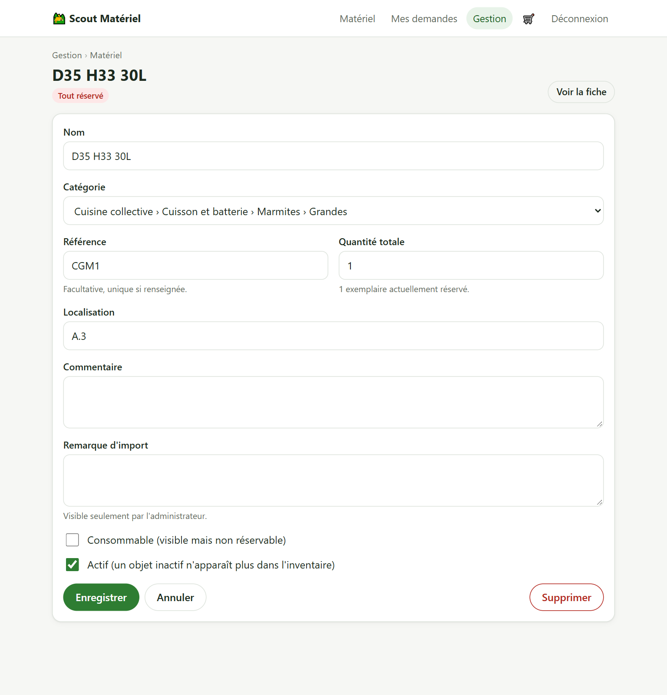

### Organiser les catégories

**Gestion › Catégories** montre l'arborescence, sur 4 niveaux au plus : Famille → Sous-catégorie 1 → 2 → 3. Cochez **Consommable** sur une catégorie pour rendre tous ses objets, et ceux de ses sous-catégories, non réservables (badge « Consommable (hérité) »). **+ Nouvelle catégorie** et **✎** ouvrent le formulaire : nom, catégorie parente, case Consommable.

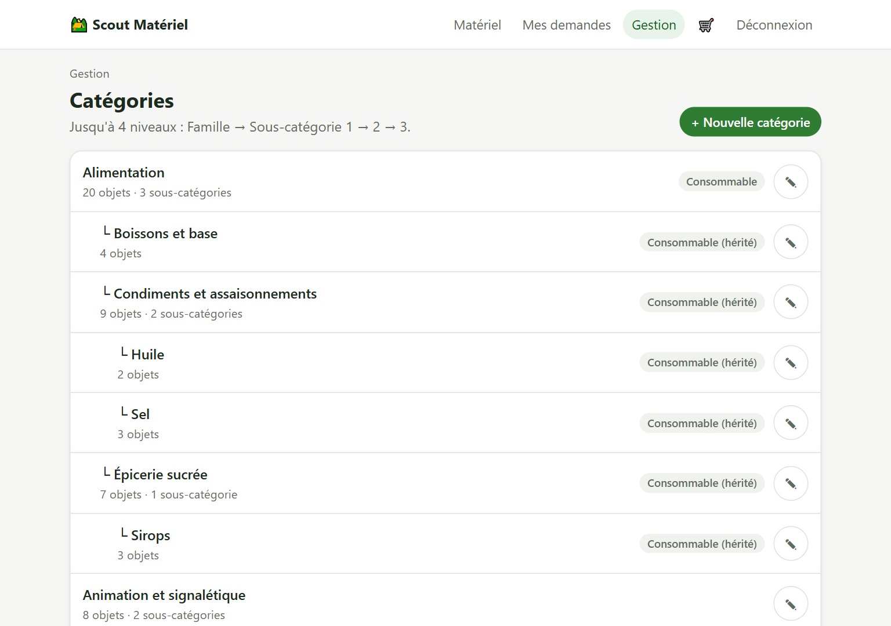

### Créer les comptes et envoyer les invitations

**Gestion › Comptes** liste les comptes avec leur rôle et leur dernière connexion. Les badges signalent les comptes **Désactivés** et les **Invitations en attente** (mot de passe pas encore choisi).

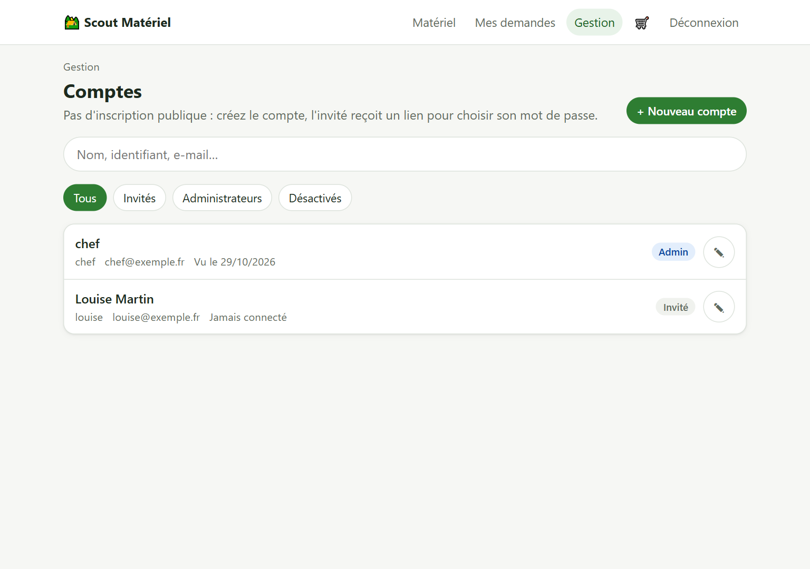

Pour inviter quelqu'un, cliquez sur **+ Nouveau compte**, renseignez identifiant, e-mail, prénom et nom, laissez cochée **Envoyer l'invitation par e-mail**, puis **Créer le compte**. Cochez **Administrateur** seulement pour un autre gestionnaire du matériel.

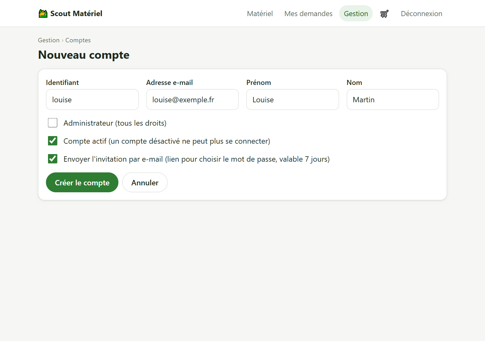

Sur la fiche d'un compte, **✉️ Renvoyer l'invitation** envoie un nouveau lien si le premier a expiré ; pour un compte déjà actif, le même bouton envoie un lien pour choisir un nouveau mot de passe. Décochez **Compte actif** pour bloquer l'accès d'une personne qui a quitté le groupe.

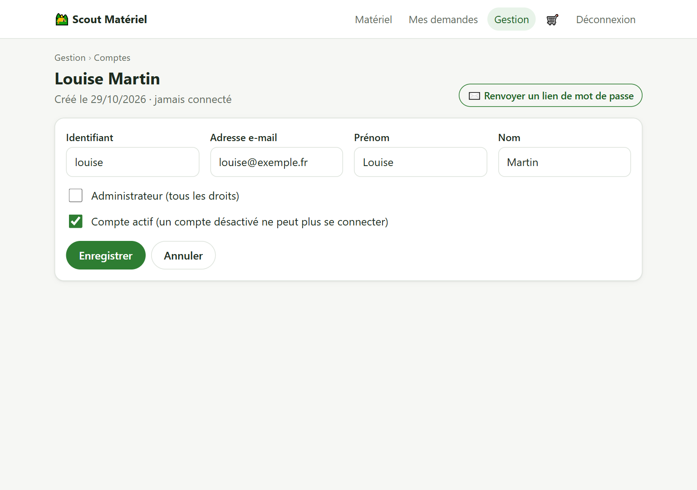

### Mettre à jour l'inventaire par Excel

**Gestion › Import Excel** charge la nomenclature (.xlsx, onglet « Nomenclature »). L'import peut être relancé sans risque : les objets existants sont mis à jour, pas dupliqués.

1. Choisissez le fichier et vérifiez le nom de l'onglet.
2. Laissez cochée **Simulation** et cliquez sur **Simuler** : le rapport s'affiche sans rien enregistrer.
3. Lisez le rapport : compteurs, doublons signalés à vérifier, lignes fusionnées, avertissements.
4. Si tout est correct, décochez **Simulation** et cliquez sur **Importer**.

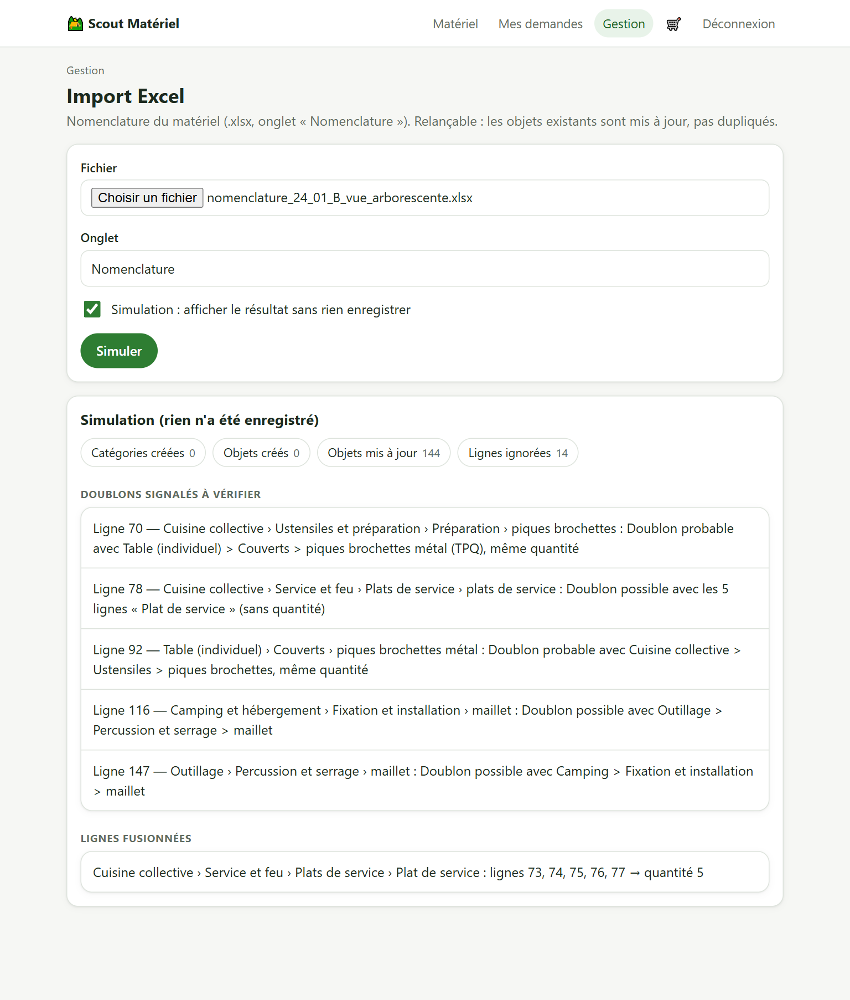

Règles appliquées : les lignes « X » et « Emplacement libre » sont ignorées, les lignes identiques sans référence sont fusionnées (quantités additionnées), et les familles « Alimentation » et « Consommables » sont marquées consommables.

### Choisir qui reçoit les listes de matériel

**Gestion › Réglages** indique à quelles adresses partent les e-mails destinés à l'administrateur : chaque nouvelle demande (avec la liste du matériel demandé et son emplacement), les annulations par les invités et la sauvegarde hebdomadaire de la base.

1. Saisissez une ou plusieurs adresses dans **Adresses e-mail des destinataires**, séparées par une virgule (par exemple celle du responsable matériel et celle du chef de groupe).
2. Cliquez sur **Enregistrer**. Une adresse mal écrite est signalée et rien n'est enregistré ; les doublons sont retirés.
3. Le cadre **Destinataires actuels** confirme les adresses utilisées et leur origine.

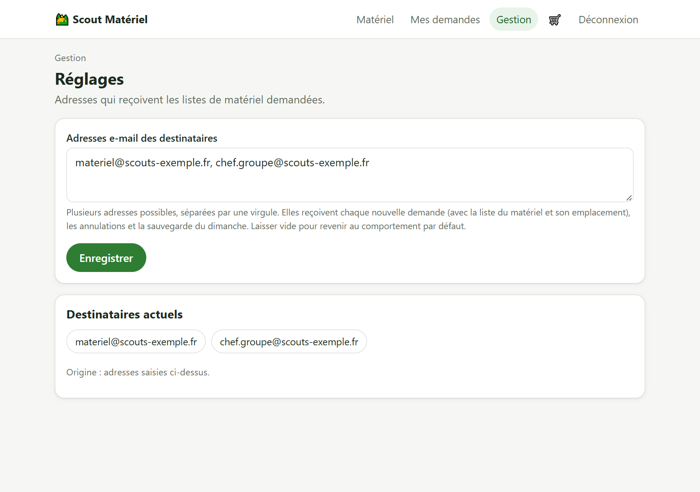

Si le champ est vide, l'application utilise l'adresse prévue dans la configuration du serveur, ou à défaut l'e-mail des comptes administrateurs. Videz le champ et enregistrez pour revenir à ce fonctionnement. Le réglage prend effet tout de suite, sans redémarrage.

## 4. Règles à connaître

La règle de base : **disponible = quantité totale − exemplaires réservés**. Une demande en attente ne bloque rien ; seule la décision « Réserver » de l'administrateur retire du matériel du stock disponible.

### Statuts d'un article

| Statut | Qui le donne | Effet sur le stock |
| --- | --- | --- |
| En attente | Envoi de la demande par l'invité | Aucun : deux invités peuvent demander le même objet. |
| Réservé | Administrateur | Les exemplaires sont bloqués pour l'invité. |
| Refusé | Administrateur | Aucun. |
| Annulé | Invité (articles en attente seulement) | Aucun. |
| Rendu | Administrateur, au retour | Les exemplaires redeviennent disponibles. |

Le statut d'une demande se déduit de ses articles : « En attente » tant qu'un article attend une décision, « Réservée » tant que du matériel est sorti, « Terminée » quand plus rien n'attend ni n'est sorti, « Annulée » si l'invité a tout annulé avant décision.

### E-mails envoyés

| Événement | Destinataires |
| --- | --- |
| Nouvelle demande | Les adresses de **Gestion › Réglages**, et l'invité (confirmation) |
| Annulation par l'invité | Les adresses de **Gestion › Réglages** |
| Création de compte ou renvoi d'invitation | La personne invitée (lien valable 7 jours) |
| Mot de passe oublié | La personne qui l'a demandé |
| Décisions de l'administrateur | Personne : l'invité consulte **Mes demandes** |

Un e-mail qui ne part pas (serveur de messagerie indisponible) ne bloque jamais l'enregistrement de la demande.

### Ce que voit chacun

- Un objet entièrement réservé disparaît pour les invités ; l'administrateur le voit toujours, avec le badge « Tout réservé ».
- Un objet inactif n'apparaît que dans **Gestion › Matériel**.
- Les consommables (objet ou catégorie marqués) sont visibles par tous mais jamais réservables.
- Les demandes en attente des autres invités ne sont visibles que par l'administrateur.

## 5. Questions fréquentes

**Je n'ai pas reçu l'e-mail d'invitation.** Vérifiez les indésirables. Sinon, demandez à l'administrateur de cliquer sur **✉️ Renvoyer l'invitation** depuis votre fiche de compte.

**Le lien affiche « Lien expiré ».** Un lien sert une seule fois et dure 7 jours. Cliquez sur **Recevoir un nouveau lien** et saisissez votre e-mail, ou demandez un renvoi à l'administrateur.

**J'ai oublié mon mot de passe.** Sur la page de connexion, cliquez sur **Mot de passe oublié ?** et suivez le lien reçu par e-mail. Connecté, vous pouvez le changer depuis la carte **Mon mot de passe** de l'accueil.

**Mon compte est bloqué après plusieurs essais.** Après 5 mots de passe erronés, la connexion est suspendue 15 minutes. Patientez, ou utilisez « Mot de passe oublié ».

**Un objet a disparu de la liste.** Il est soit entièrement réservé par d'autres demandes, soit désactivé par l'administrateur. Il réapparaîtra quand des exemplaires seront rendus.

**Je ne peux pas ajouter un objet au panier.** C'est un consommable (badge gris) : il est listé pour information. Signalez votre besoin directement à l'administrateur.

**L'envoi de ma demande est refusé.** Un objet du panier a été réservé entre-temps. Le message indique lequel : baissez la quantité ou retirez-le, puis renvoyez.

**Je veux modifier une demande déjà envoyée.** Annulez les articles en attente et refaites une demande, ou demandez à l'administrateur. Un article déjà réservé ne peut être libéré que par lui.

**Les demandes n'arrivent pas dans la bonne boîte mail.** Ouvrez **Gestion › Réglages** : le cadre **Destinataires actuels** montre les adresses utilisées. Corrigez-les (plusieurs adresses séparées par une virgule) puis enregistrez.

**Installer l'application sur mon téléphone.** Ouvrez le site dans le navigateur, puis « Ajouter à l'écran d'accueil » (menu ⋮ sur Android, bouton Partager sur iPhone). L'icône ouvre le site en plein écran.
